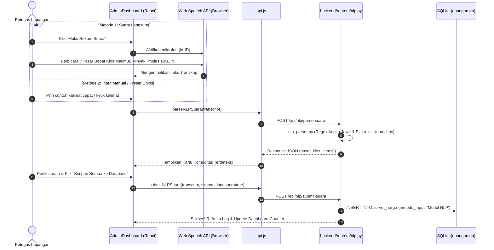

# 📋 TASK GUIDE: REVITALISASI MODUL NLP SUARA & PERBAIKAN BUG E-PANGAN

> **Panduan Teknis & Rencana Aksi Komprehensif**  
> Dibuat untuk panduan perbaikan desain antarmuka, penanganan bug kritis, dan penyempurnaan alur kerja Modul Input Cepat Suara (*Natural Language Processing*) pada aplikasi **E-Pangan Kabupaten Lamongan**.

---

## 📌 DAFTAR ISI
1. [Ringkasan Eksekutif & Sasaran Utama](#1-ringkasan-eksekutif--sasaran-utama)
2. [Audit Masalah & Bug Saat Ini (Root Cause Analysis)](#2-audit-masalah--bug-saat-ini-root-cause-analysis)
3. [Rancangan Desain & Tata Letak Baru (UI/UX Blueprint)](#3-rancangan-desain--tata-letak-baru-uiux-blueprint)
4. [Arsitektur Integrasi NLP (Frontend & Backend)](#4-arsitektur-integrasi-nlp-frontend--backend)
5. [Panduan Langkah Implementasi (Step-by-Step Implementation)](#5-panduan-langkah-implementasi-step-by-step-implementation)
6. [Daftar Kosa Kata NLP & Kasus Uji (Test Cases)](#6-daftar-kosa-kata-nlp--kasus-uji-test-cases)
7. [Checklist Verifikasi & Quality Assurance](#7-checklist-verifikasi--quality-assurance)

---

## 1. RINGKASAN EKSEKUTIF & SASARAN UTAMA

Modul Input Suara NLP dirancang sebagai **fitur inovasi utama** bagi petugas lapangan (enumerator) DKPP Kabupaten Lamongan untuk mencatat harga bahan pokok di pasar secara cepat hanya dengan berbicara menggunakan dialek percakapan tawar-menawar pasar (campuran Bahasa Indonesia dan Bahasa Daerah Jawa Timur).

### Sasaran Utama Pembaruan:
- **Zero Bug:** Menghilangkan error JavaScript runtime saat tombol rekam ditekan.
- **Tampilan Interaktif & Modern:** Menghadirkan antarmuka rekaman suara berstandar modern (indikator denyut visual/gelombang suara, tombol cepat uji kalimat, kartu hasil parsing yang terstruktur rapi).
- **Sinkronisasi Data Sempurna:** Menghubungkan hasil parsing transkrip langsung ke database survei lapangan dengan verifikasi satu-klik.
- **Dukungan Dual-Input:** Menyediakan input via Mikrofon Langsung (*Web Speech API*) dan mode Input Teks Cepat (*Manual Fallback*) agar modul tetap dapat diuji tanpa perangkat mikrofon.

---

## 2. AUDIT MASALAH & BUG SAAT INI (ROOT CAUSE ANALYSIS)

Berdasarkan audit menyeluruh terhadap kode sumber di `frontend/src/AdminDashboard.jsx`, `frontend/src/api.js`, dan `backend/routers/nlp.py`, ditemukan beberapa kendala yang menyebabkan modul belum berjalan maksimal:

### 🔴 Bug Kritis 1: `handleToggleRecord is not defined`
* **Lokasi:** `frontend/src/AdminDashboard.jsx` (Baris 837)
* **Kondisi:** Tombol `<button onClick={handleToggleRecord}>` dipanggil di antarmuka tab "Input Suara (NLP)", namun fungsi `handleToggleRecord` **belum dideklarasikan** sama sekali di dalam komponen.
* **Akibat:** Aplikasi langsung mengalami *crash* / *blank page* dengan pesan error `ReferenceError: handleToggleRecord is not defined` saat tombol diklik.

### 🔴 Bug Kritis 2: Mismatch Struktur Data `parsedResult`
* **Lokasi:** `frontend/src/AdminDashboard.jsx` (Baris 869–880)
* **Kondisi:** Komponen UI mencoba membaca nilai tunggal:
  ```jsx
  parsedResult.komoditas; // Undefined!
  parsedResult.harga; // Undefined!
  ```
  Padahal backend `backend/nlp_parser.py` mengembalikan struktur multi-item:
  ```json
  {
    "status": "success",
    "akurasi": 98.4,
    "pasar": "Pasar Babat",
    "kios": "Kios Makmur",
    "items": [
      {
        "nama_komoditas": "Minyak Goreng Sawit",
        "harga": 15000,
        "satuan": "liter",
        "status_het": "Sesuai HET"
      },
      {
        "nama_komoditas": "Beras Medium (IR 64)",
        "harga": 13000,
        "satuan": "kg",
        "status_het": "Sesuai HET"
      }
    ]
  }
  ```
* **Akibat:** Meskipun backend berhasil mem-parsing kalimat panjang dengan banyak komoditas, kartu hasil di layar tetap kosong atau bertuliskan *undefined*.

### 🟡 Kendala 3: Belum Terpasang Web Speech API di Browser
* **Kondisi:** Modul belum menghubungkan API browser bawaan (`window.SpeechRecognition` atau `window.webkitSpeechRecognition`) untuk mendengarkan mikrofon secara langsung tanpa instalasi library luar yang berat.

### 🟡 Kendala 4: Belum Ada Tombol "Simpan ke Database"
* **Kondisi:** Setelah transkrip dianalisis, petugas belum memiliki tombol aksi untuk menyimpan hasil rekomendasi ke tabel `survei_harga` dan memperbarui counter dashboard secara otomatis.

---

## 3. RANCANGAN DESAIN & TATA LETAK BARU (UI/UX BLUEPRINT)

Tata letak tab **"Input Suara (NLP)"** di `AdminDashboard.jsx` akan dirombak dengan tata letak 3 segmen modern:

```
+-----------------------------------------------------------------------------------+
|  [MODUL INPUT CEPAT NLP] [Model Dialek Lamongan / Jatim]                          |
|  Judul: Asisten Suara Enumerator Lapangan DKPP                                    |
+-----------------------------------------------------------------------------------+
|  BAGIAN 1: KONTROL PEREKAM & DUAL-INPUT SELECTOR                                  |
|  +---------------------------------------+  +----------------------------------+  |
|  | [Opsi A] Mikrofon Live (Web Speech)   |  | [Opsi B] Uji Teks Cepat (Manual) |  |
|  | [ Tombol Mic Bulat Besar (Animasi) ]  |  | [ Input Teks Transkrip Kalimat ] |  |
|  | Status: "Mendengarkan..." / "Siap"    |  | [ Tombol: Analisis Kalimat NLP ] |  |
|  +---------------------------------------+  +----------------------------------+  |
|  Contoh Kalimat Cepat (Chips Satu-Klik):                                          |
|  [Contoh 1: Minyak & Beras] [Contoh 2: Cabai & Bawang] [Contoh 3: Daging Ayam]   |
+-----------------------------------------------------------------------------------+
|  BAGIAN 2: STATUS TRANSKRIPSI & TINGKAT KEYAKINAN                                 |
|  "Pasar Babat Kios Makmur, Minyak Goreng limolas ewu sak liter, Beras ..."        |
|  Indikator: Pasar [Pasar Babat] | Kios [Kios Makmur] | Akurasi [98.4%]            |
+-----------------------------------------------------------------------------------+
|  BAGIAN 3: KARTU HASIL DETEKSI KOMODITAS & TINDAKAN                               |
|  +-----------------------------------------------------------------------------+  |
|  | Komoditas: Minyakita  | Harga: Rp 15.000/liter | [Sesuai HET] | Blok A Sayur |  |
|  +-----------------------------------------------------------------------------+  |
|  | Komoditas: Beras IR64 | Harga: Rp 13.000/kg    | [Sesuai HET] | Blok B Beras |  |
|  +-----------------------------------------------------------------------------+  |
|  Aksi: [✓ Simpan Semua ke Database Survei]  [↺ Ulangi Perekaman]                   |
+-----------------------------------------------------------------------------------+
```

---

## 4. ARSITEKTUR INTEGRASI NLP (FRONTEND & BACKEND)



---

## 5. PANDUAN LANGKAH IMPLEMENTASI (STEP-BY-STEP)

### Langkah 1: Tambahkan Speech Recognition Helper di `AdminDashboard.jsx`
Deklarasikan handler Web Speech API dengan dukungan lintas-browser:

```javascript
// Inisialisasi Speech Recognition
const initSpeechRecognition = () => {
  const SpeechRecognition = window.SpeechRecognition || window.webkitSpeechRecognition;
  if (!SpeechRecognition) return null;
  const recognition = new SpeechRecognition();
  recognition.lang = "id-ID";
  recognition.continuous = false;
  recognition.interimResults = false;
  return recognition;
};
```

### Langkah 2: Buat Fungsi `handleToggleRecord`
Tambahkan logika aktivasi mikrofon dan pemanggilan API otomatis:

```javascript
const handleToggleRecord = () => {
  if (isRecording) {
    if (window._recognitionInstance) {
      window._recognitionInstance.stop();
    }
    setIsRecording(false);
    return;
  }

  const recognition = initSpeechRecognition();
  if (!recognition) {
    if (showToast) showToast("Browser tidak mendukung Speech Recognition bawaan. Gunakan input teks.", "warning");
    return;
  }

  window._recognitionInstance = recognition;
  setIsRecording(true);

  recognition.onstart = () => {
    if (showToast) showToast("Mendengarkan... Silakan sebutkan harga komoditas", "info");
  };

  recognition.onresult = async (event) => {
    const speechResult = event.results[0][0].transcript;
    setTranscript(speechResult);
    setIsRecording(false);
    await handleAnalyzeTranscript(speechResult);
  };

  recognition.onerror = (err) => {
    console.error("Speech Recognition Error:", err);
    setIsRecording(false);
    if (showToast) showToast("Gagal merekam suara: " + (err.error || "Izin mikrofon ditolak"), "error");
  };

  recognition.onend = () => {
    setIsRecording(false);
  };

  recognition.start();
};
```

### Langkah 3: Buat Fungsi `handleAnalyzeTranscript` & Preset Contoh
```javascript
const handleAnalyzeTranscript = async (textToParse) => {
  const text = textToParse || transcript;
  if (!text.trim()) return;

  setIsProcessingNLP(true);
  try {
    const res = await prosesSuaraNLP(text);
    setParsedResult(res);
    if (showToast) showToast(`Berhasil mendeteksi ${res.items?.length || 0} komoditas!`, "success");
  } catch (err) {
    if (showToast) showToast("Gagal memproses NLP: " + err.message, "error");
  } finally {
    setIsProcessingNLP(false);
  }
};
```

### Langkah 4: Buat Fungsi `handleSaveNLPToDatabase`
```javascript
const handleSaveNLPToDatabase = async () => {
  if (!transcript || !parsedResult?.items?.length) return;

  setIsLoading(true);
  try {
    await submitNLPSuara(transcript, true);
    if (showToast) showToast("Seluruh data berhasil dicatat ke survei harian!", "success");
    setParsedResult(null);
    setTranscript("");
    // Refresh tabel & counter dashboard
    await fetchSurvei();
    await fetchDashboard();
  } catch (err) {
    if (showToast) showToast("Gagal menyimpan ke database: " + err.message, "error");
  } finally {
    setIsLoading(false);
  }
};
```

### Langkah 5: Sinkronisasi Tampilan JSX pada Kartu Hasil
Ubah rendering hasil parsing dari nilai tunggal menjadi pemetaan array `items`:
```jsx
{parsedResult && parsedResult.items && (
  <div style={{ marginTop: "16px", display: "flex", flexDirection: "column", gap: "10px" }}>
    <div style={{ display: "flex", gap: "10px", alignItems: "center" }}>
      <span className="badge-pasar">Pasar: <strong>{parsedResult.pasar}</strong></span>
      <span className="badge-kios">Kios: <strong>{parsedResult.kios}</strong></span>
      <span className="badge-akurasi">Akurasi: <strong>{parsedResult.akurasi}%</strong></span>
    </div>

    {parsedResult.items.map((item, idx) => (
      <div key={idx} style={{ padding: "12px", border: "1px solid #e2e8f0", borderRadius: "10px" }}>
        <div style={{ fontWeight: "700" }}>{item.nama_komoditas} ({item.kualitas_mutu})</div>
        <div style={{ color: "#059669", fontWeight: "800" }}>Rp {item.harga.toLocaleString("id-ID")} / {item.satuan}</div>
        <div style={{ fontSize: "11px", color: "#64748b" }}>Status: {item.status_het}</div>
      </div>
    ))}

    <button onClick={handleSaveNLPToDatabase} className="btn-simpan-nlp">
      ✓ Simpan Semua ke Database Survei
    </button>
  </div>
)}
```

---

## 6. DAFTAR KOSA KATA NLP & KASUS UJI (TEST CASES)

Tabel acuan pengujian transkrip lokal Jawa Timur yang sudah didukung oleh `backend/nlp_parser.py`:

| Kalimat Uji (Input Pengguna) | Harapan Deteksi Komoditas | Harapan Deteksi Harga | Pasar & Kios |
| :--- | :--- | :--- | :--- |
| `"Pasar Babat Kios Makmur, Minyak Goreng limolas ewu sak liter"` | Minyak Goreng Sawit | Rp 15.000 / liter | Pasar Babat - Kios Makmur |
| `"Beras IR Enam puluh empat Telulas ewu sak kilo"` | Beras Medium (IR 64) | Rp 13.000 / kg | Standar Default |
| `"Cabai Rawit abang seket ewu sak kilo ning Stan Mbak Sri"` | Cabai Rawit Merah | Rp 50.000 / kg | Stan Mbak Sri |
| `"Gula pasir selawe ewu, bawang abang telung puluh lima ewu"` | Gula Pasir Curah & Bawang Merah | Rp 25.000 & Rp 35.000 | Multi-Item Detection |
| `"Daging pitik telung puluh papat ewu ning Pasar Sukodadi"` | Daging Ayam Ras | Rp 34.000 / kg | Pasar Sukodadi |

---

## 7. CHECKLIST VERIFIKASI & QUALITY ASSURANCE

Gunakan checklist ini sebelum merilis pembaruan modul NLP ke tahap produksi:

- [ ] **Bebas Crash:** Tombol `Mulai Rekam Suara` tidak lagi melempar error `handleToggleRecord is not defined`.
- [ ] **Izin Mikrofon:** Browser menampilkan dialog izin mikrofon saat pertama kali diklik.
- [ ] **Mode Alternatif:** Input teks manual berfungsi normal saat mikrofon tidak tersedia.
- [ ] **Chips Contoh:** Menekan chip contoh otomatis mengisi teks dan menjalankan parser NLP.
- [ ] **Multi-Item Terdeteksi:** Kalimat dengan lebih dari 1 komoditas memunculkan seluruh kartu komoditas dengan benar.
- [ ] **Penyimpanan Database:** Menekan "Simpan Semua ke Database" berhasil menambahkan baris baru di tabel `survei_harga` dengan label `metode_input = 'Modul NLP'`.
- [ ] **Pembaruan UI Realtime:** Counter "Input Hari Ini" pada dashboard otomatis bertambah tanpa reload halaman.
- [ ] **Responsif:** Tampilan rapi dan proporsional baik pada layar desktop maupun tablet/smartphone enumerator.
